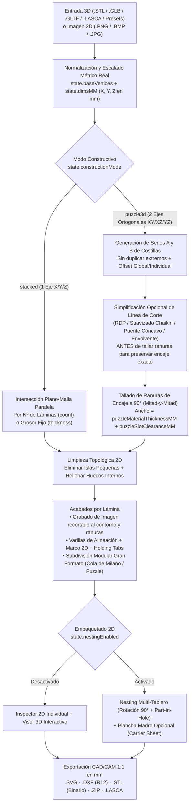

# Arquitectura y Manual Operativo OKF para Agentes de IA: LayerStudio 3D (`v3.0.6`)

> **Autor**: Norberto Martín Afonso (`normaafo@gmail.com`)  
> **Repositorio**: `https://github.com/nmarafo/layerstudio3D`  
> **Licencia**: GNU Affero General Public License v3.0 or later (con cláusula Sección 7b de atribución obligatoria)  
> **Versión OKF**: `1.3.0` (`urn:okf:software:layerstudio3d:2026:v3.0.6`)

---

## 1. Propósito de este Paquete OKF (Open Knowledge Framework)

Este documento y el manifiesto raíz [`okf.json`](../okf.json) proporcionan a cualquier **Agente de Inteligencia Artificial** (agentes de automatización de navegador como Playwright/Puppeteer/ Browser-Use, agentes de codificación o modelos de lenguaje en NotebookLM / Claude / Gemini / ChatGPT) una **especificación determinista** sobre cómo utilizar **LayerStudio 3D** de principio a fin sin ambigüedad.

Un agente de IA puede interactuar con **LayerStudio 3D** por **tres vías complementarias**:
1. **Vía API Programática Directa (`window.applyOkfProjectConfig` y funciones globales JS)**: La vía más rápida y determinista cuando el agente tiene acceso a `page.evaluate()` o consola JS.
2. **Vía Interfaz DOM por Pestañas (`#sidebarTabNav` y controles `#...`)**: Para agentes visuales o de automatización DOM que interactúan mediante clics e inputs HTML.
3. **Vía Generación de Proyectos `.lasca` / `.json`**: Para LLMs que diseñan configuraciones de corte láser o impresión 3D listas para cargarse con el botón **📂 Abrir `.lasca`**.

---

## 2. Diagrama del Pipeline Geométrico de LayerStudio 3D



---

## 3. Mapa de Navegación de la Interfaz (UI Workflow Tabs)

Desde la versión `3.0.6`, el panel lateral izquierdo (`<aside>`) organiza sus **6 tarjetas numeradas** en **5 pestañas de flujo de trabajo** (`#sidebarTabNav`) para reducir la carga visual sin eliminar ninguna funcionalidad:

| Pestaña | Selector DOM | Llamada JS Directa | Tarjetas Visibles | Qué se configura en esta etapa |
| :--- | :--- | :--- | :--- | :--- |
| **1. Corte** | `#sidebarTab_cut` | `setSidebarTab('cut')` | `#sidebarCard_1`, `#sidebarCard_2` | Modo **Apilado (1 Eje)** vs **Puzzle 3D (2 Ejes)**, selección de ejes, número de láminas/costillas, grosor de material, holgura de ranuras, movimiento/ocultación individual de costillas y simplificación de línea de corte. |
| **2. Limpieza** | `#sidebarTab_clean` | `setSidebarTab('clean')` | `#sidebarCard_3`, `#sidebarCard_4` | **Subdivisión Modular** para piezas mayores que la cama láser (conectores cola de milano, puzzle, espiga o recto) y **Limpieza de Geometría 2D** (eliminar islas pequeñas y rellenar huecos internos). |
| **3. Acabado** | `#sidebarTab_finish` | `setSidebarTab('finish')` | `#sidebarCard_5` | **Grabado de imagen en lámina seleccionada**, numeración láser, guías de ensamblaje superior/inferior, perforaciones de varillas, marco exterior 2D y pestañas de sujeción (*holding tabs*). |
| **4. Tableros** | `#sidebarTab_boards` | `setSidebarTab('boards')` | `#sidebarCard_6` | **Nesting 2D en tablero**, rotación 90°, anidamiento en huecos internos, recorte al borde de cama y **Plancha Madre (*Carrier Sheet*)**. |
| **Ver Todo** | `#sidebarTab_all` | `setSidebarTab('all')` | `#sidebarCard_1` a `#sidebarCard_6` | Muestra todas las tarjetas simultáneamente en el panel lateral. |

> **Nota para Agentes DOM**: Cada tarjeta `#sidebarCard_1` .. `#sidebarCard_6` puede plegarse o desplegarse con `toggleSidebarCard(1..6)`. Si necesitan que todos los controles del panel lateral estén visibles a la vez, ejecuten `setSidebarTab('all')`.

---

## 4. Catálogo Exhaustivo de Selectores DOM y Controles Interactivos

### 4.1. Barra Superior (Carga, Escala Métrica, Presets y Exportación)
* **Abrir archivo 3D / Proyecto (`.stl`, `.glb`, `.gltf`, `.lasca`, `.json`)**: `<input type="file" id="fileInput">`
* **Abrir estudio Vectorizador 2D (`.png`, `.bmp`, `.jpg`)**: `onclick="openVectorizerModal()"`
* **Guardar proyecto `.lasca`**: `onclick="exportProjectFile()"`
* **Modelos 3D de prueba (Presets)**:
  * Toroide: `onclick="loadPresetModel('torus')"`
  * Jarrón: `onclick="loadPresetModel('vase')"`
  * Engranaje: `onclick="loadPresetModel('gear')"`
  * Cristal: `onclick="loadPresetModel('crystal')"`
* **Escalado Métrico del Modelo 3D**:
  * Ancho X: `#dimInputX` → `onDimensionInputChange('x', valor)`
  * Fondo Y: `#dimInputY` → `onDimensionInputChange('y', valor)`
  * Alto Z: `#dimInputZ` → `onDimensionInputChange('z', valor)`
  * Candado de proporción: `#lockAspectBtn` → `toggleLockAspectRatio()`
  * Escalar lado mayor a medida exacta: `#maxDimQuickInput` → `applyModelMaxSize(valor)`
  * Unidad de visualización (`mm` / `cm`): `#unitBtn_mm`, `#unitBtn_cm` → `setDisplayUnit('mm' | 'cm')`

### 4.2. Tarjeta 1 y 2 (`1. Corte`): Modo Constructivo, Laminado y Puzzle 3D
* **Selector de Modo Constructivo**:
  * Apilado 1 Eje: `#modeConstruct_stacked` → `setConstructionMode('stacked')`
  * Puzzle 3D 2 Ejes: `#modeConstruct_puzzle3d` → `setConstructionMode('puzzle3d')`
* **Controles exclusivos del Modo Apilado (`stacked`)**:
  * Eje de corte: `#axisBtn_x`, `#axisBtn_y`, `#axisBtn_z` → `setSliceAxis('x' | 'y' | 'z')`
  * Modo de cálculo: `#modeBtn_count` (Nº Láminas) / `#modeBtn_thickness` (Grosor Fijo) → `setSliceMode('count' | 'thickness')`
  * Cantidad de láminas: `#sliceCountSlider`, `#sliceCountInput` (`2..120`) → `onSliceCountChange(val)` / `stepSliceCount(-1 | 1)`
  * Grosor de material: `#thicknessInput` → `onThicknessChange(val)`
* **Controles exclusivos del Modo Puzzle 3D (`puzzle3d`)**:
  * Par de ejes ortogonales: `#puzzleAxes_xy`, `#puzzleAxes_xz`, `#puzzleAxes_yz` → `setPuzzleAxes('xy' | 'xz' | 'yz')`
  * Nº de costillas Serie A: `#puzzleCountASlider`, `#puzzleCountAInput` → `onPuzzleCountChange('A', val)` / `stepPuzzleCount('A', -1 | 1)`
  * Nº de costillas Serie B: `#puzzleCountBSlider`, `#puzzleCountBInput` → `onPuzzleCountChange('B', val)` / `stepPuzzleCount('B', -1 | 1)`
  * Modo de margen inicial: `#puzzleStartMode_start` (`Desde inicio`), `#puzzleStartMode_symmetric` (`Simétrico`), `#puzzleStartMode_shift` (`Desplazar`) → `setPuzzleStartMode(mode)`
  * Posición inicio Serie A / Serie B: `#puzzleStartASlider`, `#puzzleStartAInput`, `#puzzleStartBSlider`, `#puzzleStartBInput` → `onPuzzleStartOffsetChange('A' | 'B', val)`
  * **Mover SOLO la costilla seleccionada**: `#selectedRibOffsetSlider`, `#selectedRibOffsetInput` → `onSelectedRibOffsetChange(val)`, `stepSelectedRibOffset(-1 | 1)`, `resetSelectedRibOffset()`
  * **Visibilidad 3D de ejes y costillas**:
    * Ocultar/Mostrar Eje A: `#btnToggleVisSeriesA` → `togglePuzzleSeriesVisibility('A')`
    * Ocultar/Mostrar Eje B: `#btnToggleVisSeriesB` → `togglePuzzleSeriesVisibility('B')`
    * Ocultar/Mostrar Costilla Activa: `#btnToggleVisSelectedRib` → `toggleSelectedRibVisibility()`
    * Mostrar todas: `#btnShowAllPuzzleRibs` → `showAllPuzzleRibs()`
  * **Grosor del tablero y holgura de ranuras (Kerf)**:
    * Grosor tablero: `#puzzleThicknessInput` → `onPuzzleMaterialChange(val)`
    * Holgura encaje: `#puzzleClearanceInput` → `onPuzzleClearanceChange(val)`
  * **Simplificación de línea de corte en Puzzle 3D**:
    * Activar/Desactivar: `#puzzleSimplifyCheck` → `setPuzzleSimplifyCutLine(bool)`
    * Algoritmo: `#puzzleSimplifyModeSelect` (`'rdp'` Poligonal Directo, `'smooth'` Curva Suave Chaikin, `'bridge'` Puente de Concavidades, `'convex'` Envolvente Exterior)
    * Tolerancia (mm): `#puzzleSimplifyTolSlider`, `#puzzleSimplifyTolInput` (`0.2..25 mm`)
    * Pasadas de suavizado: `#puzzleSimplifyPassesInput` (`0..5`)

### 4.3. Tarjeta 3 y 4 (`2. Limpieza`): Subdivisión Modular y Limpieza 2D
* **Subdivisión Modular (Gran Formato)**:
  * Activar: `#splitModelCheck` → `setSplitModelEnabled(bool)`
  * Modo: `#splitMode_max_size` (Por Tamaño de Cama) / `#splitMode_grid` (Por Rejilla $N \times M$)
  * Ancho/Alto máx. pieza: `#splitMaxWInput`, `#splitMaxHInput`
  * Tipo de conector mecánico: `#splitJointSelect` (`'dovetail'` Cola de Milano, `'puzzle'` Conector Puzzle, `'finger'` Espiga Recta, `'straight'` Corte Recto)
  * Profundidad del conector: `#splitJointDepthInput`
  * Alternar juntas entre capas (aparejo tipo ladrillo): `#splitStaggerCheck`
* **Limpieza de Geometría 2D**:
  * Eliminar islas pequeñas: `#filterIslandsCheck` → `setFilterSmallIslands(bool)`
  * Tamaño mínimo de isla: `#minIslandSizeInput`, criterio `#minIslandCriteriaSelect` (`'max_dim'`, `'min_dim'`, `'area'`)
  * Rellenar huecos internos: `#fillHolesCheck` → `setFillInternalHoles(bool)`
  * Modo de relleno: `#fillHolesModeSelect` (`'all'` Todos los huecos — Pieza maciza, `'max_size'` Solo huecos menores al umbral `#fillHolesMaxSizeInput`)

### 4.4. Tarjeta 5 (`3. Acabado`): Grabado de Imagen por Lámina, Guías, Varillas, Marco y Pestañas
* **Grabado de Imagen en la Lámina Seleccionada (`slice.imageEngraving`)**:
  * Botón en Inspector 2D: `#btnSliceImgUpload` (`🖼️ Grabar Imagen`) y `#btnSliceImgEditVec` (`🎛️ Vectorizador`)
  * Botón en Panel Lateral: `#btnSidebarSliceImgUpload` y `#btnSidebarSliceImgVec`
  * Modo de grabado: `#sliceImgModeSelect` (`'contour'` Contornos Vectoriales, `'hatch'` Relleno Rayado Láser, `'both'` Contorno + Relleno, `' relief'` Niveles tonales)
  * Escala (%): `#sliceImgScaleSlider`, `#sliceImgScaleInput` → `setSliceImageEngravingParams('scalePct', val)`
  * Posición X / Y (mm): `#sliceImgOffsetXInput`, `#sliceImgOffsetYInput` → `setSliceImageEngravingParams('offsetXMM' | 'offsetYMM', val)`
  * Rotación (°): `#sliceImgRotInput` → `setSliceImageEngravingParams('rotationDeg', val)`
  * Umbral B/N (`5..250`): `#sliceImgThresholdInput` → `setSliceImageEngravingParams('threshold', val)`
  * Paso de rayado láser (`0.3..8 mm`): `#sliceImgHatchInput` → `setSliceImageEngravingParams('hatchSpacingMM', val)`
  * Invertir B/N y Espejo X: `#sliceImgInvertCheck`, `#sliceImgFlipXCheck`
* **Numeración, Guías, Varillas, Marco 2D y Pestañas (Holding Tabs)**:
  * Grabar numeración: `#labelCheck` → `setIncludeLabels(bool)`
  * Guía capa superior ($N+1$): `#nextGuideCheck` → `setIncludeNextGuide(bool)`
  * Guía capa inferior ($N-1$): `#prevGuideCheck` → `setIncludePrevGuide(bool)`
  * Varillas de alineación: `#rodCountSelect` (`0`, `1`, `2`, `3`), diámetro `#rodDiameterInput`
  * Marco exterior 2D: `#slicerFrameCheck` → `setSlicerFrameEnabled(bool)`
  * Pestañas de sujeción (*Holding Tabs*): `#tabsEnabledCheck` → `setHoldingTabsEnabled(bool)`

### 4.5. Tarjeta 6 (`4. Tableros`): Nesting Multi-Tablero y Plancha Madre
* **Activar Nesting en Tablero**: `#nestingCheck` → `setNestingEnabled(bool)`
* **Dimensiones del tablero (mm/cm)**: `#boardWidthInput`, `#boardHeightInput` o `#boardPresetSelect`
* **Separación entre piezas y margen exterior**: `#nestSpacingInput`, `#nestMarginInput`
* **Rotación óptima 90° y uso de huecos internos (*Part-in-Hole*)**: `#nestRotateCheck`, `#nestUseHolesCheck`
* **Plancha Madre (*Carrier Sheet*)**: `#carrierCheck` → `setCarrierEnabled(bool)`, dimensiones `#carrierWidthInput`, `#carrierHeightInput`

---

## 5. Playbooks Operativos Paso a Paso para Agentes de IA

### Playbook A: Configurar un Proyecto Completo con una Sola Llamada (`applyOkfProjectConfig`)
Cuando un agente de IA se ejecuta en el navegador (o vía Playwright/Puppeteer), puede configurar cualquier proyecto en un único paso determinista:

```javascript
window.applyOkfProjectConfig({
  presetModel: 'vase',               // 'torus' | 'vase' | 'gear' | 'crystal'
  modelName: 'jarron_puzzle_laser',
  maxDimensionMM: 220,               // Escala el modelo proporcionalmente a 220 mm de alto
  constructionMode: 'puzzle3d',      // 'stacked' | 'puzzle3d'
  puzzleAxes: 'xz',                  // Costillas verticales en X y Z
  puzzleCountA: 7,
  puzzleCountB: 7,
  puzzleMaterialThicknessMM: 4.0,    // Contrachapado de 4.0 mm
  puzzleSlotClearanceMM: 0.15,       // Holgura láser (ancho ranura = 4.15 mm)
  puzzleSimplifyCutLine: true,       // Simplificar línea de corte preservando ranuras
  puzzleSimplifyMode: 'smooth',      // 'rdp' | 'smooth' | 'bridge' | 'convex'
  puzzleSimplifyToleranceMM: 1.5,
  puzzleSimplifySmoothPasses: 2,
  filterSmallIslands: true,
  fillInternalHoles: true,
  nestingEnabled: true,
  boardWidthMM: 600,
  boardHeightMM: 400,
  nestSpacingMM: 3,
  nestMarginMM: 5,
  nestAllowRotate: true,
  nestUseInnerHoles: true
});
```

### Playbook B: Mover u Ocultar una Costilla Individual en Modo Puzzle 3D
1. Seleccionar la costilla deseada por su índice (`0 .. state.slices.length - 1`):
   ```javascript
   selectActiveSlice(3); // Selecciona la 4ª costilla
   ```
2. Desplazar **únicamente esa costilla** $+6.5\text{ mm}$ a lo largo de su eje (recalculando automáticamente su contorno real 3D y desplazando las ranuras correspondientes en todas las costillas perpendiculares):
   ```javascript
   onSelectedRibOffsetChange(6.5);
   ```
3. Ocultar o mostrar en la vista 3D la costilla activa o todo un eje para inspeccionar encajes internos:
   ```javascript
   toggleSelectedRibVisibility();      // Oculta/muestra solo la costilla activa
   togglePuzzleSeriesVisibility('A');  // Oculta/muestra todo el Eje A
   showAllPuzzleRibs();                // Restaura todas las costillas
   ```

### Playbook C: Grabar una Imagen Vectorizada en la Lámina Seleccionada
Para estampar programáticamente o desde el Vectorizador 2D un grabado láser dentro de la lámina activa (recortando automáticamente cualquier trazo que caiga fuera de la lámina o dentro de una ranura de encaje Puzzle 3D):

1. Seleccionar la lámina destino:
   ```javascript
   selectActiveSlice(0);
   ```
2. Si el usuario carga una imagen mediante `#sliceImageEngraveInput` o desde el estudio Vectorizador (`openSliceImageInVectorizerModal()`), ajustar parámetros en tiempo real:
   ```javascript
   setSliceImageEngravingParams('mode', 'both');        // 'contour' | 'hatch' | 'both' | 'relief'
   setSliceImageEngravingParams('scalePct', 75);        // 75% del tamaño de la lámina
   setSliceImageEngravingParams('hatchSpacingMM', 1.2); // Rayado cada 1.2 mm
   ```
3. Los trazos resultantes se almacenan en `state.slices[state.activeSliceIndex].imageEngraving.clippedPaths` y se exportan automáticamente en la capa magenta `#d946ef` (`GRABADO_TEXTO`) tanto en `.SVG` como en `.DXF`.

### Playbook D: Exportar Archivos de Producción
* **Exportar `.SVG` de todos los tableros o láminas**: `exportAllSVGLayout()`
* **Exportar `.ZIP` con `.SVG` individuales + hoja de resumen**: `exportZipAllSVGs()`
* **Exportar `.DXF` (AutoCAD R12) con capas por color**: `exportAllDXFLayout()`
* **Exportar `.ZIP` con modelos `.STL` para impresión 3D**: `exportZipAllSTLs()`
* **Guardar proyecto `.lasca`**: `exportProjectFile()`
