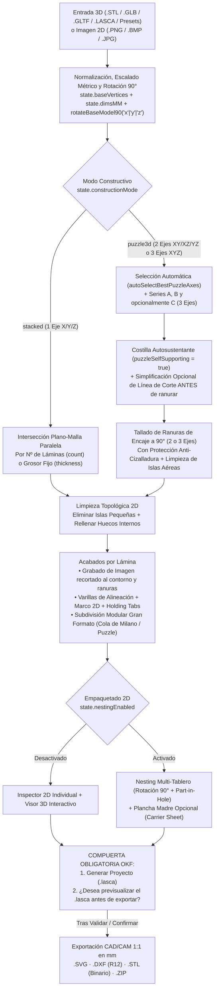

# Arquitectura y Manual Operativo OKF para Agentes de IA: LayerStudio 3D (`v3.0.15`)

> **Autor**: Norberto Martín Afonso (`normaafo@gmail.com`)  
> **Repositorio**: `https://github.com/nmarafo/layerstudio3D`  
> **Licencia**: GNU Affero General Public License v3.0 or later (con cláusula Sección 7b de atribución obligatoria)  
> **Versión OKF**: `1.3.0` (`urn:okf:software:layerstudio3d:2026:v3.0.15`)

---

## 1. Propósito de este Paquete OKF (Open Knowledge Framework)

Este documento y el manifiesto raíz [`okf.json`](../okf.json) proporcionan a cualquier **Agente de Inteligencia Artificial** (agentes de automatización de navegador como Playwright/Puppeteer/ Browser-Use, agentes de codificación o modelos de lenguaje en NotebookLM / Claude / Gemini / ChatGPT) una **especificación determinista** sobre cómo utilizar **LayerStudio 3D** de principio a fin sin ambigüedad.

Un agente de IA puede interactuar con **LayerStudio 3D** por **tres vías complementarias**:
1. **Vía API Programática Directa (`window.applyOkfProjectConfig` y funciones globales JS)**: La vía más rápida y determinista cuando el agente tiene acceso a `page.evaluate()` o consola JS.
2. **Vía Interfaz DOM por Pestañas (`#sidebarTabNav` y controles `#...`)**: Para agentes visuales o de automatización DOM que interactúan mediante clics e inputs HTML.
3. **Vía Generación de Proyectos `.lasca` / `.json`**: Para LLMs que diseñan configuraciones de corte láser o impresión 3D listas para cargarse con el botón **📂 Abrir `.lasca`**.

---

## 2. Diagrama del Pipeline Geométrico y Compuerta de Previsualización `.lasca`



---

## 3. Mapa de Navegación de la Interfaz (UI Workflow Tabs)

Desde la versión `3.0.6`, el panel lateral izquierdo (`<aside>`) organiza sus **6 tarjetas numeradas** en **5 pestañas de flujo de trabajo** (`#sidebarTabNav`) para reducir la carga visual sin eliminar ninguna funcionalidad:

| Pestaña | Selector DOM | Llamada JS Directa | Tarjetas Visibles | Qué se configura en esta etapa |
| :--- | :--- | :--- | :--- | :--- |
| **1. Corte** | `#sidebarTab_cut` | `setSidebarTab('cut')` | `#sidebarCard_1`, `#sidebarCard_2` | Modo **Apilado (1 Eje)** vs **Puzzle 3D (2 Ejes)**, selección de ejes, número de láminas/costillas, grosor de material, holgura de ranuras, movimiento/ocultación individual de costillas y simplificación de línea de corte. |
| **2. Limpieza** | `#sidebarTab_clean` | `setSidebarTab('clean')` | `#sidebarCard_3`, `#sidebarCard_4` | **Subdivisión Modular** para piezas mayores que la cama láser (conectores cola de milano, puzzle, espiga o recto) y **Limpieza de Geometría 2D** (eliminar islas pequeñas y rellenar huecos internos). |
| **3. Acabado** | `#sidebarTab_finish` | `setSidebarTab('finish')` | `#sidebarCard_5` | **Grabado de imagen en lámina seleccionada**, numeración láser, guías de ensamblaje superior/inferior, perforaciones de varillas, marco exterior 2D y pestañas de sujeción (*holding tabs*). |
| **4. Tableros** | `#sidebarTab_boards` | `setSidebarTab('boards')` | `#sidebarCard_6` | **Nesting 2D en tablero**, rotación 90°, anidamiento en huecos internos, recorte al borde de cama y **Plancha Madre (*Carrier Sheet*)**. |
| **Ver Todo** | `#sidebarTab_all` | `setSidebarTab('all')` | `#sidebarCard_1` a `#sidebarCard_6` | Muestra todas las tarjetas simultáneamente en el panel lateral. |

> **Nota para Agentes DOM**: Cada tarjeta `#sidebarCard_1` .. `#sidebarCard_6` puede plegarse o desplegarse con `toggleSidebarCard(1..6)`. Si necesitan que todos los controles del panel lateral estén visibles a la vez, ejecuten `setSidebarTab('all')`.

---

## 4. Catálogo Exhaustivo de Selectores DOM y Controles Interactivos

### 4.1. Barra Superior (Carga, Escala Métrica, Presets y Exportación)
* **Abrir archivo 3D / Proyecto (`.stl`, `.glb`, `.gltf`, `.lasca`, `.json`)**: `<input type="file" id="fileInput">`
* **Abrir estudio Vectorizador 2D (`.png`, `.bmp`, `.jpg`)**: `onclick="openVectorizerModal()"`
* **Guardar proyecto `.lasca`**: `onclick="exportProjectFile()"`
* **Modelos 3D de prueba (Presets)**:
  * Toroide: `onclick="loadPresetModel('torus')"`
  * Jarrón: `onclick="loadPresetModel('vase')"`
  * Engranaje: `onclick="loadPresetModel('gear')"`
  * Cristal: `onclick="loadPresetModel('crystal')"`
* **Escalado Métrico del Modelo 3D**:
  * Ancho X: `#dimInputX` → `onDimensionInputChange('x', valor)`
  * Fondo Y: `#dimInputY` → `onDimensionInputChange('y', valor)`
  * Alto Z: `#dimInputZ` → `onDimensionInputChange('z', valor)`
  * Candado de proporción: `#lockAspectBtn` → `toggleLockAspectRatio()`
  * Escalar lado mayor a medida exacta: `#maxDimQuickInput` → `applyModelMaxSize(valor)`
  * Unidad de visualización (`mm` / `cm`): `#unitBtn_mm`, `#unitBtn_cm` → `setDisplayUnit('mm' | 'cm')`

### 4.2. Tarjeta 1 y 2 (`1. Corte`): Modo Constructivo, Laminado y Puzzle 3D
* **Selector de Modo Constructivo**:
  * Apilado 1 Eje: `#modeConstruct_stacked` → `setConstructionMode('stacked')`
  * Puzzle 3D 2 Ejes: `#modeConstruct_puzzle3d` → `setConstructionMode('puzzle3d')`
* **Controles exclusivos del Modo Apilado (`stacked`)**:
  * Eje de corte: `#axisBtn_x`, `#axisBtn_y`, `#axisBtn_z` → `setSliceAxis('x' | 'y' | 'z')`
  * Modo de cálculo: `#modeBtn_count` (Nº Láminas) / `#modeBtn_thickness` (Grosor Fijo) → `setSliceMode('count' | 'thickness')`
  * Cantidad de láminas: `#sliceCountSlider`, `#sliceCountInput` (`2..120`) → `onSliceCountChange(val)` / `stepSliceCount(-1 | 1)`
  * Grosor de material: `#thicknessInput` → `onThicknessChange(val)`
* **Controles exclusivos del Modo Puzzle 3D (`puzzle3d`)**:
  * Rotación rápida 90° del modelo y costillas: `onclick="rotateBaseModel90('x' | 'y' | 'z')"` (`↻ X 90°`, `↻ Y 90°`, `↻ Z 90°`)
  * Combinación de ejes ortogonales (2 o 3 ejes): `#puzzleAxesBtn_xy`, `#puzzleAxesBtn_xz`, `#puzzleAxesBtn_yz`, `#puzzleAxesBtn_xyz` → `setPuzzleAxes('xy' | 'xz' | 'yz' | 'xyz')` y botón `🪄 Auto` → `autoSelectBestPuzzleAxes(false)`
  * **Costilla Autosustentante (sin bajar al suelo, sujeta por la unión — Activa por defecto)**:
    * Activar/Desactivar: `#puzzleSelfSupportingCheck` → `setPuzzleSelfSupporting(bool)`
    * Objetivo: `#puzzleSelfSupTargetBtn_outer` (`Exteriores`), `#puzzleSelfSupTargetBtn_series_b` (`Serie B`), `#puzzleSelfSupTargetBtn_series_a` (`Serie A`), `#puzzleSelfSupTargetBtn_all` (`Todas`) → `setPuzzleSelfSupportTarget('outer' | 'series_b' | 'series_a' | 'all' | 'custom')`
    * Estilo de base suspendida: `#puzzleSelfSupportStyleSelect` (`'trim_union'` Recorte recto bajo unión, `'arch'` Arco aligerado entre uniones, `'natural'` Solo silueta 3D real sin pedestal) → `onPuzzleSelfSupportParamsChange()`
    * Altura libre desde el suelo (mm): `#puzzleSelfSupportClearanceSlider`, `#puzzleSelfSupportClearanceInput` → `onPuzzleSelfSupportClearanceInput(val)` / `stepPuzzleSelfSupportClearance(deltaMM)`
    * Descartar islas aéreas sin unión: `#puzzleDropUnconnectedCheck` (`puzzleDropUnconnectedIslands: true`)
    * Alternar soporte individual en la costilla seleccionada: `#puzzleToggleRibSelfSupBtn` / `#inspToggleRibSelfSupBtn` → `toggleSelectedPuzzleRibSelfSupporting()`
  * Nº de costillas Serie A: `#puzzleCountASlider`, `#puzzleCountAInput` → `onPuzzleCountChange('a', val)` / `stepPuzzleCount('a', -1 | 1)`
  * Nº de costillas Serie B: `#puzzleCountBSlider`, `#puzzleCountBInput` → `onPuzzleCountChange('b', val)` / `stepPuzzleCount('b', -1 | 1)`
  * Nº de costillas Serie C (modo 3 ejes `'xyz'`): `#puzzleCountCSlider`, `#puzzleCountCInput` (`#puzzleSeriesCBox`) → `onPuzzleCountChange('c', val)` / `stepPuzzleCount('c', -1 | 1)`
  * Modo de margen inicial: `#puzzleStartMode_start` (`Desde inicio`), `#puzzleStartMode_symmetric` (`Simétrico`), `#puzzleStartMode_shift` (`Desplazar`) → `setPuzzleStartMode(mode)`
  * Posición inicio Serie A / Serie B: `#puzzleStartASlider`, `#puzzleStartAInput`, `#puzzleStartBSlider`, `#puzzleStartBInput` → `onPuzzleStartOffsetChange('A' | 'B', val)`
  * **Mover SOLO la costilla seleccionada**: `#selectedRibOffsetSlider`, `#selectedRibOffsetInput` → `onSelectedRibOffsetChange(val)`, `stepSelectedRibOffset(-1 | 1)`, `resetSelectedRibOffset()`
  * **Visibilidad 3D de ejes y costillas**:
    * Ocultar/Mostrar Eje A: `#btnToggleVisSeriesA` → `togglePuzzleSeriesVisibility('A')`
    * Ocultar/Mostrar Eje B: `#btnToggleVisSeriesB` → `togglePuzzleSeriesVisibility('B')`
    * Ocultar/Mostrar Costilla Activa: `#btnToggleVisSelectedRib` → `toggleSelectedRibVisibility()`
    * Mostrar todas: `#btnShowAllPuzzleRibs` → `showAllPuzzleRibs()`
  * **Grosor del tablero y holgura de ranuras (Kerf)**:
    * Grosor tablero: `#puzzleThicknessInput` → `onPuzzleMaterialChange(val)`
    * Holgura encaje: `#puzzleClearanceInput` → `onPuzzleClearanceChange(val)`
  * **Simplificación de línea de corte en Puzzle 3D**:
    * Activar/Desactivar: `#puzzleSimplifyCheck` → `setPuzzleSimplifyCutLine(bool)`
    * Algoritmo: `#puzzleSimplifyModeSelect` (`'rdp'` Poligonal Directo, `'smooth'` Curva Suave Chaikin, `'bridge'` Puente de Concavidades, `'convex'` Envolvente Exterior)
    * Tolerancia (mm): `#puzzleSimplifyTolSlider`, `#puzzleSimplifyTolInput` (`0.2..25 mm`)
    * Pasadas de suavizado: `#puzzleSimplifyPassesInput` (`0..5`)

### 4.3. Tarjeta 3 y 4 (`2. Limpieza`): Subdivisión Modular y Limpieza 2D
* **Subdivisión Modular (Gran Formato)**:
  * Activar: `#splitModelCheck` → `setSplitModelEnabled(bool)`
  * Modo: `#splitMode_max_size` (Por Tamaño de Cama) / `#splitMode_grid` (Por Rejilla $N \times M$)
  * Ancho/Alto máx. pieza: `#splitMaxWInput`, `#splitMaxHInput`
  * Tipo de conector mecánico: `#splitJointSelect` (`'dovetail'` Cola de Milano, `'puzzle'` Conector Puzzle, `'finger'` Espiga Recta, `'straight'` Corte Recto)
  * Profundidad del conector: `#splitJointDepthInput`
  * Alternar juntas entre capas (aparejo tipo ladrillo): `#splitStaggerCheck`
* **Limpieza de Geometría 2D**:
  * Eliminar islas pequeñas: `#filterIslandsCheck` → `setFilterSmallIslands(bool)`
  * Tamaño mínimo de isla: `#minIslandSizeInput`, criterio `#minIslandCriteriaSelect` (`'max_dim'`, `'min_dim'`, `'area'`)
  * Rellenar huecos internos: `#fillHolesCheck` → `setFillInternalHoles(bool)`
  * Modo de relleno: `#fillHolesModeSelect` (`'all'` Todos los huecos — Pieza maciza, `'max_size'` Solo huecos menores al umbral `#fillHolesMaxSizeInput`)

### 4.4. Tarjeta 4 y 5 (`2. Limpieza` / `3. Acabado`): Grabado de Imagen en Lasca, Costillas Extremas de Puzzle 3D, Guías, Varillas, Marco y Pestañas
* **Grabado de Imagen en Lasca / Costilla Seleccionada (`state.sliceImageEngravings` y `slice.engraveLoops`)**:
  * **Regla de Diseño en Puzzle 3D (`puzzle3d`)**: En un Puzzle 3D entrelazado, las costillas intermedias conforman el armazón estructural interior, mientras que **las costillas primera y última de cada eje** (ej. `X1` y `XN` en la Serie A, y/o `Y1`/`Z1` y `YM`/`ZM` en la Serie B) actúan como **fachadas exteriores visibles**. Por ello, **lo habitual al diseñar un Puzzle 3D es grabar las costillas primera y última de los ejes** empleando la función existente de grabar imagen en lasca, la cual recorta automáticamente todos los trazos del grabado (`#008800` / capa DXF `C00`) al contorno real de la costilla y evita invadir las ranuras de encaje a 90° (`slice.slots`).
  * Botón en Inspector 2D: `#btnInspectorEngraveSliceImg` (`🖼️ Grabar Imagen`) → despliega `#sliceImageEngravePanel`
  * Botón directo para estampar en 1.ª y última costilla de los ejes: `#btnEngravePuzzleEndRibs` (`🧩 1.ª y Última Costilla (Ejes)`) → `applyEngravingToPuzzleEndRibs()`
  * Carga de imagen personalizada (`.png`, `.bmp`, `.jpg`, `.webp`): `#fileInputSliceEngraveImg` → `handleSliceImageEngraveFile(file)`
  * Presets integrados de prueba: `applyDemoImageEngravingToSelectedSlice('drawing' | 'crest' | 'medallion' | 'badge')`
  * Abrir estudio Vectorizador 2D apuntando a la lasca activa: `openVectorizerForSelectedSlice()` y transferir con `applyVectorizedImageToSelectedSlice()`
  * Modo de detección: `#sliceEngraveModeSelect` (`'smart_drawing'` Trazos + Relleno, `'line_art'` Solo Líneas, `'global_threshold'` Silueta / Sombra)
  * Escala (%): `#sliceEngraveScaleInput` → `stepSelectedSliceEngraveScale(delta)` / `setSliceImageEngravingParams('scalePct', val)`
  * Posición X / Y (mm): `#sliceEngraveOffsetXInput`, `#sliceEngraveOffsetYInput` → `setSliceImageEngravingParams('offsetXMM' | 'offsetYMM', val)`
  * Rotación 90° y Espejo Horizontal (`flipX`): `rotateSelectedSliceEngraving(90)`, `#btnSliceEngraveFlipX` → `toggleSelectedSliceEngravingFlipX()`
  * Umbral B/N (`15..245`): `#sliceEngraveThresholdSlider` → `setSliceImageEngravingParams('threshold', val)`
  * Recorte automático al contorno y ranuras: `#sliceEngraveClipCheck` (`clipToSlice: true` por defecto)
* **Numeración, Guías, Varillas, Marco 2D y Pestañas (Holding Tabs)**:
  * Grabar numeración: `#labelCheck` → `setIncludeLabels(bool)`
  * Guía capa superior ($N+1$): `#nextGuideCheck` → `setIncludeNextGuide(bool)`
  * Guía capa inferior ($N-1$): `#prevGuideCheck` → `setIncludePrevGuide(bool)`
  * Varillas de alineación: `#rodCountSelect` (`0`, `1`, `2`, `3`), diámetro `#rodDiameterInput`
  * Marco exterior 2D: `#slicerFrameCheck` → `setSlicerFrameEnabled(bool)`
  * Pestañas de sujeción (*Holding Tabs*): `#tabsEnabledCheck` → `setHoldingTabsEnabled(bool)`

### 4.5. Tarjeta 6 (`4. Tableros`): Nesting Multi-Tablero y Plancha Madre
* **Activar Nesting en Tablero**: `#nestingCheck` → `setNestingEnabled(bool)`
* **Dimensiones del tablero (mm/cm)**: `#boardWidthInput`, `#boardHeightInput` o `#boardPresetSelect`
* **Separación entre piezas y margen exterior**: `#nestSpacingInput`, `#nestMarginInput`
* **Rotación óptima 90° y uso de huecos internos (*Part-in-Hole*)**: `#nestRotateCheck`, `#nestUseHolesCheck`
* **Plancha Madre (*Carrier Sheet*)**: `#carrierCheck` → `setCarrierEnabled(bool)`, dimensiones `#carrierWidthInput`, `#carrierHeightInput`

---

## 5. Playbooks Operativos Paso a Paso para Agentes de IA

### Playbook A: Configurar un Proyecto Completo con una Sola Llamada (`applyOkfProjectConfig`)
Cuando un agente de IA se ejecuta en el navegador (o vía Playwright/Puppeteer), puede configurar cualquier proyecto en un único paso determinista:

```javascript
window.applyOkfProjectConfig({
  presetModel: 'vase',               // 'torus' | 'vase' | 'gear' | 'crystal'
  modelName: 'jarron_puzzle_laser',
  maxDimensionMM: 220,               // Escala el modelo proporcionalmente a 220 mm de alto
  constructionMode: 'puzzle3d',      // 'stacked' | 'puzzle3d'
  puzzleAxes: 'xz',                  // Costillas verticales en X y Z
  puzzleCountA: 7,
  puzzleCountB: 7,
  puzzleMaterialThicknessMM: 4.0,    // Contrachapado de 4.0 mm
  puzzleSlotClearanceMM: 0.15,       // Holgura láser (ancho ranura = 4.15 mm)
  puzzleSimplifyCutLine: true,       // Simplificar línea de corte preservando ranuras
  puzzleSimplifyMode: 'smooth',      // 'rdp' | 'smooth' | 'bridge' | 'convex'
  puzzleSimplifyToleranceMM: 1.5,
  puzzleSimplifySmoothPasses: 2,
  puzzleEngraveEndRibs: true,        // Grabar automáticamente la 1.ª y última costilla de los ejes
  puzzleEngraveEndRibsAxes: 'both',  // 'both' (Serie A y Serie B) | 'A' | 'B'
  puzzleEngraveEndRibsPreset: 'drawing', // 'drawing' | 'crest' | 'medallion' | 'badge'
  puzzleEngraveEndRibsScalePct: 75,
  puzzleEngraveEndRibsMirrorLast: true,  // Espejo horizontal (flipX) en la última costilla de cada eje
  filterSmallIslands: true,
  fillInternalHoles: true,
  nestingEnabled: true,
  boardWidthMM: 600,
  boardHeightMM: 400,
  nestSpacingMM: 3,
  nestMarginMM: 5,
  nestAllowRotate: true,
  nestUseInnerHoles: true
});
```

### Playbook B: Mover u Ocultar una Costilla Individual en Modo Puzzle 3D
1. Seleccionar la costilla deseada por su índice (`0 .. state.slices.length - 1`):
   ```javascript
   selectActiveSlice(3); // Selecciona la 4ª costilla
   ```
2. Desplazar **únicamente esa costilla** $+6.5\text{ mm}$ a lo largo de su eje (recalculando automáticamente su contorno real 3D y desplazando las ranuras correspondientes en todas las costillas perpendiculares):
   ```javascript
   onSelectedRibOffsetChange(6.5);
   ```
3. Ocultar o mostrar en la vista 3D la costilla activa o todo un eje para inspeccionar encajes internos:
   ```javascript
   toggleSelectedRibVisibility();      // Oculta/muestra solo la costilla activa
   togglePuzzleSeriesVisibility('A');  // Oculta/muestra todo el Eje A
   showAllPuzzleRibs();                // Restaura todas las costillas
   ```

### Playbook C: Grabar Imagen en Lasca (Costillas Primera y Última en Puzzle 3D o Lámina Individual)
En un **Puzzle 3D (`puzzle3d`)**, lo normal es grabar las **costillas primera y última de los ejes** (`X1` y `XN` en la Serie A; `Y1`/`Z1` y `YM`/`ZM` en la Serie B), ya que constituyen las fachadas exteriores visibles del modelo. Para ello se utiliza la función ya existente de grabar imagen en lasca, que recorta automáticamente cualquier trazo que salga del contorno o caiga sobre una ranura de encaje a 90°:

1. **Vía automática sobre la 1.ª y última costilla de los ejes**:
   ```javascript
   // Estampa el grabado (reutilizando la imagen de la lasca activa o el preset indicado) en la 1.ª y última costilla de ambos ejes:
   applyEngravingToPuzzleEndRibs({
     targetAxes: 'both',      // 'both' | 'A' | 'B'
     presetName: 'drawing',   // 'drawing' | 'crest' | 'medallion' | 'badge'
     scalePct: 75,
     mirrorLastRib: true,     // Invierte horizontalmente (flipX) la última costilla del eje para simetría exterior
     clipToSlice: true        // Recorta al contorno y evita las ranuras a 90°
   });
   ```
2. **Vía manual o individual lasca a lasca** (para personalizar una costilla extrema o cualquier lámina apilada):
   ```javascript
   // Seleccionar la primera costilla del eje A (índice 0) o cualquier lasca:
   state.activeSliceIndex = 0;
   applyDemoImageEngravingToSelectedSlice('crest'); // O cargar archivo con handleSliceImageEngraveFile(file)
   setSliceImageEngravingParams('scalePct', 80);
   setSliceImageEngravingParams('detectMode', 'smart_drawing'); // 'smart_drawing' | 'line_art' | 'global_threshold'
   ```
3. Los vectores de grabado resultantes se almacenan en `slice.engraveLoops` y se exportan automáticamente en color verde `#008800` (grupo SVG `GRABADO_VECTORIAL_IMAGEN` y capa DXF `C00` de prioridad 1).

### Playbook D: Compuerta Obligatoria de Previsualización del Proyecto (`.lasca`) antes de Exportar Archivos de Producción

> [!IMPORTANT]
> **REGLA OBLIGATORIA OKF ANTES DE EXPORTAR (`OKF-GATE-LASCA-PREVIEW-BEFORE-EXPORT`)**:  
> Antes de exportar cualquier paquete de archivos de fabricación (`.ZIP`, `.DXF`, `.SVG`, `.STL` de capas), cualquier Agente de IA **DEBE**:
> 1. **Generar primero el archivo de proyecto `.lasca`** (`exportProjectFile()`) con la configuración propuesta.
> 2. **Preguntar explícitamente a la persona usuaria si desea previsualizar el proyecto (`.lasca`) en LayerStudio 3D (`https://nmarafo.github.io/layerstudio3D/` → botón `📂 Abrir`) antes de exportar los archivos definitivos de corte**:
>    > *«He generado el archivo de proyecto `.lasca` con la configuración propuesta (combinación de ejes, número de costillas, modo autosustentante y distribución en tableros). ¿Desea previsualizar primero el proyecto `.lasca` en LayerStudio 3D antes de que exporte los archivos definitivos de corte (`.ZIP` / `.DXF` / `.SVG` / `.STL`)?»*
> 3. **Esperar la confirmación de la persona usuaria** (salvo que esta indique expresamente que desea exportar directamente sin previsualizar) antes de ejecutar las funciones de exportación final.

Una vez validado el proyecto `.lasca` por la persona usuaria, ejecutar la exportación solicitada:
* **Guardar proyecto autónomo `.lasca` (Paso 1 obligatorio antes de exportar)**: `exportProjectFile()` (si el modelo supera los `36.000` triángulos, compacta automáticamente la malla mediante `compactBaseVerticesForLasca()` en un sólido estanco 2.5D de `~5 MB` para evitar archivos JSON gigantescos).
* **Exportar `.ZIP` completo (con `SVG_Corte_Laser/`, `DXF_Corte_Laser/`, `SVG_Tableros_Anidados/`, `DXF_Tableros_Anidados/`, `STL_3D/`, `GUIA_MONTAJE_INTERACTIVA.html` y `PROYECTO_OKF.lasca`)**: `exportZipBatch()`
* **Exportar `.SVG` de todos los tableros o láminas**: `exportAllSVGLayout()`
* **Exportar `.DXF` (AutoCAD R12) con capas por color (`C00..C02` `ACI 5` Azul para grabado y `C03..C04` `ACI 1` Rojo para corte)**: `exportAllDXFLayout()`
* **Exportar `.ZIP` con modelos `.STL` para impresión 3D**: `exportZipAllSTLs()`

---

## 6. Tratamiento Automático de Mallas 3D de Alta Densidad y Modelos Huecos / «Sin Peana»

A raíz de casos reales con modelos arquitectónicos y esculturas generadas por IA o fotogrametría (p. ej. mallas `.STL` de más de `2.000.000` de triángulos con paredes huecas de `0,8 mm` y base inferior recortada a `Z = 0`), **LayerStudio 3D (`v3.0.12`)** incorpora tres salvaguardas geométricas automáticas en [`js/slicer.js`](../js/slicer.js) y [`js/exporters.js`](../js/exporters.js):

1. **Encadenamiento Bidireccional con Prioridad de Vértice Exacto (`chainSegmentsBidirectional`)**:
   - En mallas con millones de triángulos, la longitud media de los segmentos de intersección plano-triángulo puede ser inferior a `0,15 mm` (menor que la tolerancia de soldadura de brechas).
   - El algoritmo prioriza siempre la coincidencia exacta de vértice compartido (`exactTolSq = 1e-8`) antes de considerar el cierre del polígono y extiende la cadena tanto por la cola (`tail`) como por la cabeza (`head`), evitando micro-bucles falsos de 3 o 4 aristas.
2. **Reconstrucción Automática de Costillas Macizas en Mallas Huecas o con Base Abierta (`buildSolidRibLoopFromSegments`)**:
   - Cuando se diseña un **Puzzle 3D (`constructionMode: 'puzzle3d'`)** con `fillInternalHoles: true` sobre un modelo cuya cáscara interior es hueca o cuya base fue suprimida («Sin Peana»), la sección transversal cruda solo contiene paredes delgadas (`netArea < 0,38 × bboxArea`) donde las ranuras de encaje a 90° no tendrían material donde tallarse.
   - `sliceTrianglesAtPlane()` detecta automáticamente esta condición (`netArea < 0.38 * bboxArea`) y muestrea el perfil superior envolvente $v_{\max}(u)$ de todos los segmentos intersectados para cerrarlo en línea recta contra la cota base del modelo (`baseY = minZ`), generando costillas estructuralmente macizas y estables.
3. **Limpieza Automática de Esquirlas en Cumbreras Inclinadas (`carveInterlockingPuzzleSlots`)**:
   - Cuando una ranura superior a 90° coincide con un tejado o pendiente pronunciada, la sustracción booleana puede seccionar la punta superior en un pequeño triángulo residual suelto. El motor descarta automáticamente tras el booleano cualquier sub-fragmento secundario cuya área sea inferior a $\max(15\text{ mm}^2, \text{slotW}^2)$.
4. **Metadatos de Proyecto Integrados (`PROYECTO_OKF.lasca` dentro del `.ZIP`)**:
   - Todo archivo `.ZIP` generado por `exportZipBatch()` incluye en su raíz `PROYECTO_OKF.lasca` con el grosor de material (`puzzleMaterialThicknessMM`) y las dimensiones de tablero (`boardWidthMM × boardHeightMM`) para facilitar el postprocesado CAM automatizado.
5. **Selección Automática Generalizada de Ejes de Cruce en Puzzle 3D (`autoSelectBestPuzzleAxes`)**:
   - Al activar el modo `puzzle3d` o pulsar **`🪄 Auto-Elegir`**, LayerStudio 3D simula internamente las tres combinaciones ortogonales (`xy`, `xz`, `yz`) y las puntúa de `0` a `100` mediante `computePuzzleAxesCandidateScore()` según 4 métricas universales:
     1. **Estabilidad Rotacional de Encajes (`35 pts`)**: Premia que todas las costillas activas tengan $\ge 2$ ranuras y penaliza las costillas en voladizo con `1` sola ranura o `0` ranuras.
     2. **Expresividad de Silueta / Penalización de «Peines Rectangulares» (`30 pts`)**: Mide el factor de llenado $R = \frac{\text{Área}}{W \times H}$ de cada costilla antes de ranurar y penaliza las series donde las piezas son simples rectángulos planos ($R > 0,80$) sin silueta reconocible.
     3. **Cohesión Topológica (`20 pts`)**: Penaliza las combinaciones que parten una lámina en múltiples islas desconectadas ($\text{islas} > 1$) tras el tallado booleano de ranuras.
     4. **Densidad de Cruces y Cobertura Efectiva (`15 pts`)**: Evalúa la proporción de costillas activas y el número total de encajes a 90°.
6. **Modo de 3 Ejes Simultáneos (`X × Y × Z`, `puzzleAxes: 'xyz'`) y Rotación 90° de la Malla Base (`rotateBaseModel90`)**:
   - Permite entramar costillas ortogonales simultáneas en los 3 ejes (`Serie A + Serie B + Serie C`) con ranuras de encaje automático entre cada par de familias (`A-B`, `A-C`, `B-C`), o rotar físicamente la malla 3D base 90° en X, Y o Z (`rotateBaseModel90('x'|'y'|'z')`) antes de laminar.
7. **Costillas Autosustentantes en el Aire (`Costilla autosustentante`, `puzzleSelfSupporting: true` activo por defecto)**:
   - Permite que las costillas seleccionadas (`puzzleSelfSupportTarget`: `'outer'` por defecto, `'series_b'`, `'series_a'`, `'all'` o `'custom'`) no bajen hasta la mesa/suelo ($Z = \min Z$), sino que recorten su faldón inferior (`applyPuzzleSelfSupportingTrim` en modo `'trim_union'`, `'arch'` o `'natural'`) respetando un margen de seguridad alrededor de cada ranura de encaje y descartando islas aéreas desconectadas (`puzzleDropUnconnectedIslands: true`), de modo que se sujeten en el aire mediante las uniones ortogonales.
